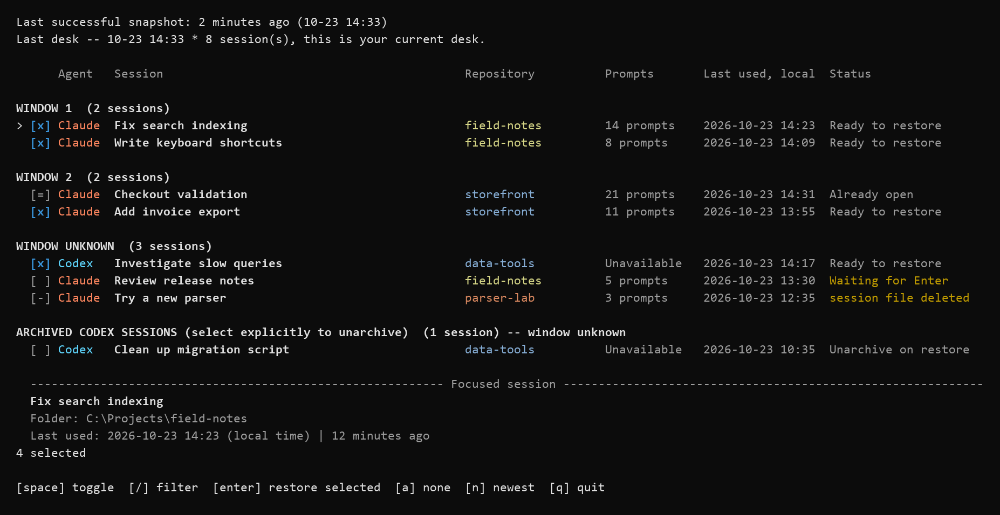
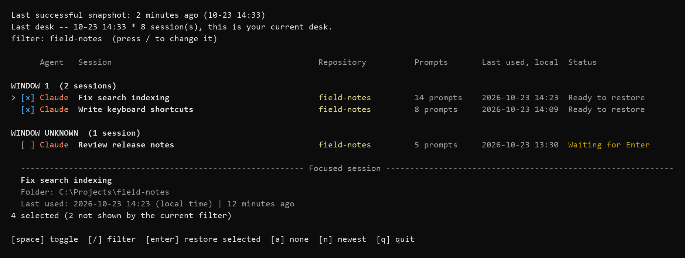

# Termsync

Termsync saves your open Claude Code and Codex sessions so you can choose which
ones to resume after a Windows restart.

If you work across several projects, a restart can leave you searching through
conversation history to rebuild the set of sessions you had open. Termsync
keeps a local inventory of that desk. It records each supported session's
identity, title, and working directory, along with Claude window and tab order
where it can identify them. After the restart, you pick the conversations you
want and reopen them in fresh Windows Terminal windows.

Claude and Codex still keep the conversations. Termsync uses their existing
resume commands, so those conversation files and your project folders must
remain available. A saved Termsync desk contains the information needed to
find those sessions; it does not contain a backup of their transcripts or your
work.



Rendered by the current picker with synthetic sessions and example folders.
[Image details](docs/images/provenance.md).

[Setup](#quick-start) · [Picker controls](#reading-the-picker) ·
[Restoring](#opening-the-selected-sessions) · [Automatic saves](#automatic-saves)

## Quick start

Termsync currently runs from a source checkout on Windows. You need Windows
Terminal (`wt.exe`) and Windows PowerShell (`powershell.exe`), plus the provider
CLIs you use (`claude` and/or `codex`) on PATH. Sign in to those CLIs first and
run Termsync under your normal interactive Windows account. Capture expects
the default `.claude` and `.codex` directories in your user profile. Capture
does not support custom provider home directories.

Use checkout and project directory paths without semicolons (`;`). Windows
Terminal treats them as command separators; Termsync refuses those paths when
restoring.

PowerShell must also permit the restore helper, `snapshot\arm.ps1`, to run.
Termsync does not change your execution policy. If scripts are blocked, see
[PowerShell script permissions](docs/USAGE.md#powershell-script-permissions)
before trying a restore.

From the checkout directory in PowerShell:

```powershell
py -3.14 -m venv .venv
.\.venv\Scripts\python.exe -m pip install -e .
.\termsync.cmd --help
.\termsync.cmd snap
```

The last command saves the supported sessions currently open on your desktop.
Run it while the conversations you want to keep are still open. To inspect the
saved desk without opening anything:

```powershell
.\termsync.cmd restore --dry-run
```

After a restart, open PowerShell in the checkout and run:

```powershell
.\termsync.cmd
```

Available sessions start selected in the picker. Use Space to change the
selection, then Enter to open the selected sessions. Each new tab waits for
another Enter before it runs the provider's resume command. You can open the
whole desk and start its conversations as you need them.

Python 3.14.2 is the tested interpreter. The package declares Python 3.11 or
newer, but earlier versions have not been tested for this release. Reading
compressed Codex rollout files through the fallback reader requires
`compression.zstd`, available in Python 3.14. There are no third-party runtime
dependencies.

Keep the source checkout in place. Termsync reads its PowerShell helpers from
the adjacent `snapshot` directory, which a standalone wheel installation does
not currently provide.

To run `termsync` from other directories, add the checkout directory to your
user PATH in Windows Environment Variables and open a new terminal. For the
current PowerShell session only, run this from the checkout:

```powershell
$env:Path = "$PWD;$env:Path"
termsync
```

The `termsync.cmd` launcher uses this checkout's `.venv` and opens the restore
picker when called without arguments. The Python entry point needs an explicit
command, such as `python -m termsync restore`. If you move the checkout, recreate
the venv and update PATH and any installed capture task.

## Saving and choosing a desk

A desk is a captured set of supported sessions. Run `termsync snap` whenever
you want to save the current set, or install the automatic task described
below. Closing a few finished tabs can produce a smaller capture. Termsync
therefore starts the picker with the largest desk from the current and previous
stored Windows boots, choosing the later capture when sizes tie. Before the
current boot has a capture, it uses the two most recent stored boots.

This gives you a way back to the fuller desk even if the newest capture was
taken after you began closing things. The header shows the capture time and
explains when a newer capture is available. Press `n` to switch between the
chosen desk and the newest capture, or start with the newest one explicitly:

```powershell
termsync restore --newest
```

Switching desks preserves your selections for sessions still available in the
new view. It does not reset every available row to selected. The picker offers
these two choices rather than a browser for the entire capture history.

For a separate saved desk, give capture and restore the same store directory:

```powershell
termsync snap --store C:\TermsyncData\evening-desk
termsync restore --dry-run --store C:\TermsyncData\evening-desk
termsync restore --store C:\TermsyncData\evening-desk
```

That capture reads your real sessions and saves their inventory in the named
directory. The scheduled task continues to use the default store. Conversation
files remain in the providers' own storage.

## Reading the picker

The picker shows the provider and session title beside the project folder.
Prompt counts come from available history; an unavailable count does not mean
the conversation is empty. Last-used times appear in your local time zone.
The focused-session panel shows the full title and folder when the table has
shortened them. On terminals narrower than 120 columns, each session uses two
lines.

| Status | Meaning |
| --- | --- |
| `Ready to restore` | The session is available. It starts selected when you first open the picker. |
| `Already open` | Termsync found the session already live; it cannot be selected. |
| `Waiting for Enter` | A previous restore recorded an armed tab. Select it explicitly only if you need to reopen a closed tab. |
| `Unarchive on restore` | This Codex session is archived and starts unchecked. Resuming it will unarchive it. |
| A file, directory, metadata, or live-check error | The session cannot currently be restored. Space explains the reason. |

The selection markers work without color: `[x]` is selected, `[ ]` is
unchecked, `[=]` is already open, and `[-]` is unavailable. Provider and folder
colors help you scan the rows, but the text carries the same information.

`WINDOW 1`, `WINDOW 2`, and similar headings describe the captured Claude
groups. They preserve the original window numbers even when filtering hides
other groups. `WINDOW UNKNOWN` contains sessions without a usable captured
position, including Codex sessions. Archived Codex sessions appear in their
own section. The `STARTED SINCE THE LAST SNAPSHOT` section can recover Claude
sessions found in newer local prompt history, provided their files and folders
are still available.

These headings describe the saved desk. During restore, selected Claude
sessions with known placement keep their relative window and tab order.
Sessions without usable placement go to a final window. Plain shell tabs are
not recreated, so gaps left by them in the original tab order disappear.

| Key | Action |
| --- | --- |
| Up / Down or `k` / `j` | Move between visible sessions. |
| Space | Toggle the focused session. |
| `/` | Start or edit a title-and-directory filter. |
| Enter while filtering | Keep the filter and stop typing. |
| Esc while filtering | Clear the filter and stop typing. |
| `a` | Clear all selections, including hidden rows. |
| `n` | Switch between the chosen desk and newest capture. |
| Enter outside filtering | Restore all selected sessions. |
| `q` | Quit without restoring. |

While typing a filter, letters such as `a`, `n`, and `q` become search text.
Filtering is case-insensitive and hides rows without deselecting them. Check
the selected count before restoring: it includes hidden selections. To restore
only a few matching sessions, clear the selection with `a`, filter the list,
finish typing with Enter, and select the rows you want.



A filtered view of the same synthetic desk. Four sessions remain selected,
including two that the filter has hidden.

## Opening the selected sessions

The normal restore path opens armed tabs. Each tab shows its saved title and
waits at `Enter to resume`. Pressing Enter runs `claude --resume` or
`codex resume` with the saved session ID in the recorded working directory.
For an archived Codex session, unarchiving also waits until this point.

If you want every selected conversation to resume as soon as its tab opens:

```powershell
termsync restore --run
```

`--run` still opens the picker. It removes the per-tab Enter step after you
choose the sessions. To inspect full session IDs and availability without
launching tabs or entering the keyboard interface, use
`termsync restore --dry-run`. That preview reads current provider and desktop
state when a saved desk exists, so it can report reader errors.

Before launching, Termsync rechecks the conversation files and working
directories. It also validates Codex resume metadata. The picker does not
continuously refresh the desktop: if you start a session elsewhere while it is
open, quit and reopen it to refresh availability.

If a provider's current-session read fails, its sessions are unavailable for
restore and the header shows the error. Sessions from a provider whose read
succeeded remain usable. Resolve the reported error, then reopen the picker.

Restore creates fresh Terminal windows and waits for each tab to become
observable before adding the next. If a window is ambiguous, a launch fails,
or a tab fails its readiness check, Termsync stops later launches and reports
the result. Tabs already accepted can remain open.
Inspect those tabs before retrying; Termsync does not automatically retry an
uncertain launch or close it for you.

Window readiness and provider identity are checked separately. An armed tab
is waiting for you, so it has no resumed provider process yet. With `--run`, a
failure to verify the exact provider session is reported as a failure, even
though a slow session could still start later.

## Automatic saves

To inspect and then register the scheduled capture task:

```powershell
termsync install --dry-run
termsync install
```

The task saves the desk every ten minutes while you are logged in, including
when running on battery. It uses the checkout's `pythonw.exe`, so captures do
not open a console. Installation reads the task back to verify its settings;
running `install` again updates the same `termsync-snap` task. Package setup
does not register it.

Sleep, shutdown, and resume events also trigger best-effort captures. Windows
can end a session before the capture finishes, and a crash can happen between
scheduled saves. Run `termsync snap` before a planned restart if the latest
changes to your desk matter.

## Capture and local data

Termsync identifies supported interactive sessions from local provider data
and Windows process information. For Claude, it checks its session registry
entries against running processes and their start times. For Codex, it combines CLI
session metadata with the process holding the session's writer lock and its
console attachment. Noninteractive Codex commands such as `exec` are excluded.

Window placement uses a separate desktop read. Claude sessions receive a
captured position only when their console and tab titles can be matched
unambiguously. Duplicate or manually changed titles can leave placement
unknown. Codex window placement is currently always unknown. You can still
restore a session with unknown placement when its identity and files are
usable.

The default store is `%USERPROFILE%\.termsync`. It holds the captured layouts
and capture status, plus records of restore actions and tabs waiting for Enter.
An unchanged inventory refreshes its existing capture instead of creating
another version. Retention keeps at least 30 days of captures and protects the
selected recovery records. Restore action records never become restore targets.

Armed tabs stay in a pending record until a capture sees their provider
sessions running or the entries reach 24 hours old. A pending record can
therefore outlast a tab you closed without resuming it.

Treat this store as private. Session IDs and project paths can identify your
work, and titles can contain conversation text. The picker also reads local
history to supply prompt information and recovery candidates. Termsync stores
its inventory locally; resumed Claude and Codex sessions use the providers'
normal behavior and settings.

## Limits and recovery

Termsync restores supported Claude Code and Codex sessions on Windows. Plain
shell and SSH tabs are outside its scope. It does not reconstruct split panes,
window geometry, or focus. Provider conversation files must survive the restart,
and project directories must still exist at their recorded paths.

The header reports capture freshness and repeated failures. If the saved desk
looks stale, run `termsync snap` to see the current error and inspect
`%USERPROFILE%\.termsync\status.json`. A missing conversation file or folder
must be restored before that session can be selected again. If the picker says
there is no saved desk, check that you used the intended store directory.

For `venv python not found`, repeat the source-checkout setup in the same
directory. For non-interactive input errors, use an interactive terminal or
`restore --dry-run`. After a partial or unverified restore, inspect the printed
result and accepted tabs before another attempt.

[Usage and recovery](docs/USAGE.md) has further details on script permissions and
restore failures. [Development](docs/DEVELOPMENT.md) covers the isolated test
suite, diagnostic tools, and source packaging. Its live restore harness opens
disposable provider sessions and is separate from the ordinary test command.

Termsync is available under the [MIT license](LICENSE), copyright 2026 Alper
Umul.
